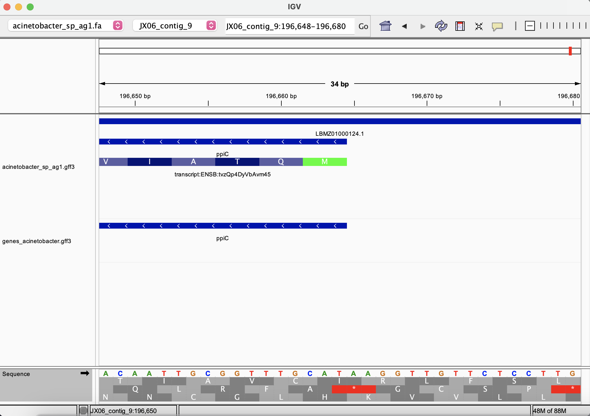
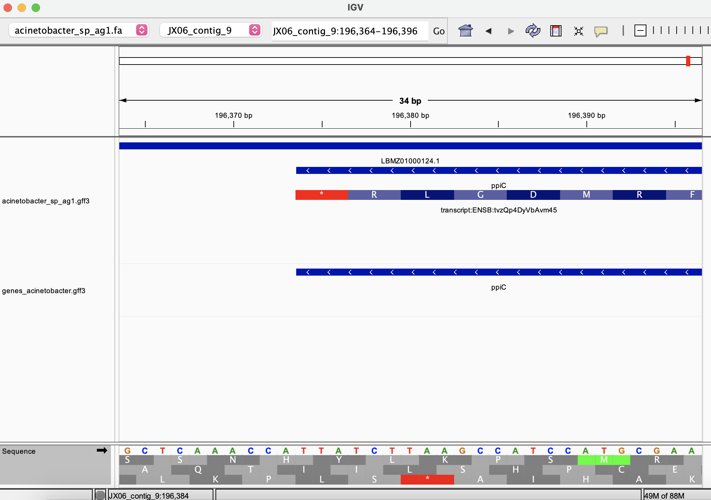
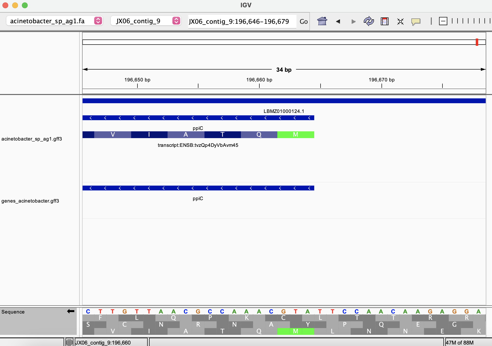
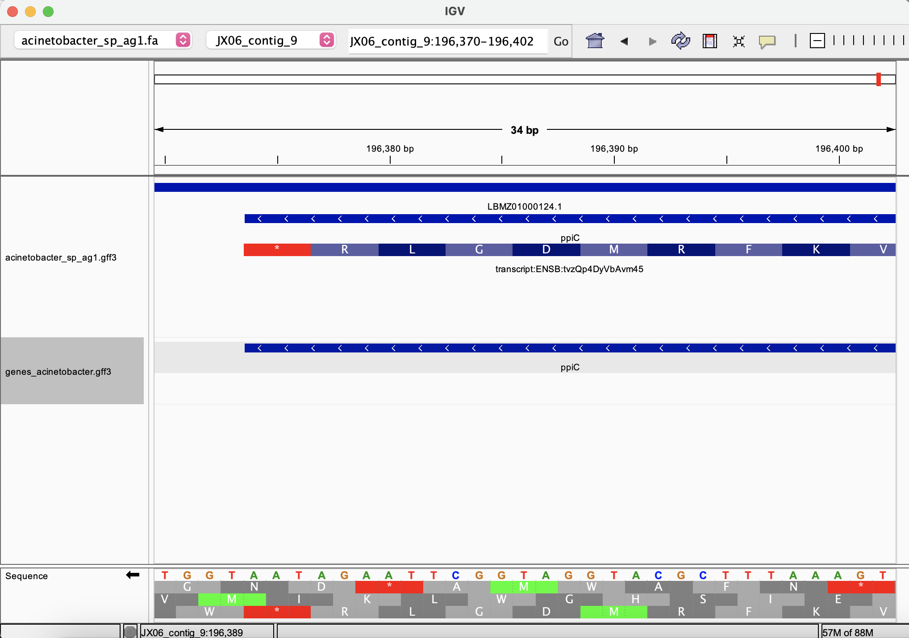

# Genomic Data Visualization

## Task
> [!NOTE]
> The questions and prompts in this section are sourced from **FastTrack Bioinformatics 2025** at **Penn State**
Address the following:

* Use IGV to visualize your genome and the annotations relative to the genome.
* How big is the genome, and how many features of each type does the GFF file contain?
* From your GFF file, separate the intervals of type "gene" or "transcript" into a different file. Show the commands you used to do this.
* Visualize the simplified GFF in IGV as a separate track. Compare the visualization of the original GFF with the simplified GFF.
* Zoom in to see the sequences, expand the view to show the translation table in IGV. Note how the translation table needs to be displayed in the correct orientation for it to make sense.
* Visually verify that the first coding sequence of a gene starts with a start codon and that the last coding sequence of a gene ends with a stop codon.

## Report
For this task, I used the https://ftp.ensemblgenomes.ebi.ac.uk/pub/bacteria/current/ and used the genome for Acinetobacter, strain AG1

* The GFF file contains 124 sequence regions and they are all contigs. I learned that contigs are continuous, uninterrupted stretches of DNA sequences that scientists have pieced together from smaller DNA reads. So for this organism, scientists know the sequences of 124 different physical stretches of the genome but not how they piece together and in what order. To get total size of all of these sequences, I counted all of the bases in the fasta file. I did that by using " grep -v '^>' " to exclude the fasta headers and piped the output to " tr -d '\n' " to get rid of the newline characters and then piped the output of that to "wc -c" to count all the bases. The total number of bases is 3 670 157!

* I cleaned up the GFF file by using grep -v to filter out lines starting with "#". Then, I used cut -f 3 to get only the third column containing the features and piped that into uniq-sort-rank-count to count and rank all the unique feature types in descending order. This is the result:
    3511	exon
    3472	CDS
    3472	gene
    3472	mRNA
    124	region
    39	ncRNA
    39	ncRNA_gene

* I discovered two different ways to separate the intervals of type 'gene' :
```sh
cat cleanGFFacinetobacter.gff3 | awk '$3 == "gene"' > genes_acinetobacter.gff3

grep $'\tgene\t' cleanGFFacinetobacter.gff3 > genes_acinetobacter2.gff3
```

* I dragged the simplified GFF on the track below the main GFF.

I can see that the botton track is only showing actual genes whereas the top track is showing
the mRNA which has that specific gene as its 'parent'. The pop up annotations also list information
about the exon that that region of the mRNA contains and info about its associated coding sequence.
 
* The following screenshots show what it looks like when the translation table is in the wrong orientation
versus the correct orientation when you make the arrow point in the same way as the "<" character on the 
gene. In the wrong orientation, none of the ORFs in the table list amino acids that match up to those listed
on the GFF track but in the correct orientation they do match. The green start and red stop codons also only
align when the table is in the correct orientation.
<table>
  <tr>
    <td></td>
    <td></td>
  </tr>
  <tr>
    <td></td>
    <td></td>
  </tr>
</table>